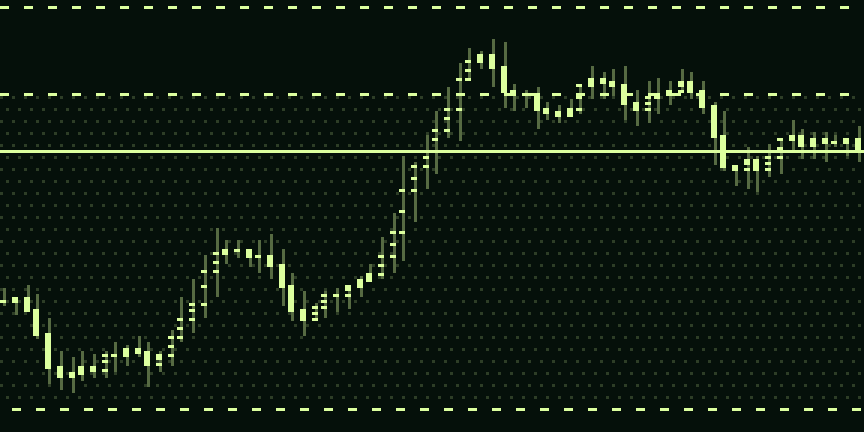

# TargetGlance

**Glanceable buy-zone / sell-zone alerts for stocks + crypto on Even Realities G2.**
Set an entry and an exit zone, read a live range bar in half a second, paper-trade with one tap.
No broker or exchange API keys, no accounts, no real orders.

Track 03 — Exchanges & Stocks · 576×288 · Even G2

```
TARGETGLANCE  PAPER $10,000   +$0 open                                 ALL
>NVDA  ▼-13.8% 119.40  ● AH                              BUY 118-122 NOW
·  hold 4 +$0 · live now                                                                    ○○
 SOL   ▼-2.1%  142.50  ○ 24-7              ●─────── 178-182
·  buy 135-140 · stale 2m                                                                        ○○○
 BTC   ▲+0.8%  97k     ◌ 24-7                     ───●──── 105k
·  buy 92k · mock                                                                                     ○○○

SWIPE select   TAP edit   LONG portfolio
```

`●` live · `○` stale · `◌` mock — and the sub-row spells it out (`live now`, `stale 2m`,
`mock`) next to the position and its ladder rungs.

---

## Run it (10 seconds)

```bash
npm i
npm run dev          # http://localhost:5173  → the G2 app
```

Open **http://localhost:5173/companion.html** for Judge Mode (simulate a dip, force mock data,
seed a portfolio, reset). Everything is one process on one port: the app and its quote service
share an origin, so there is no CORS and no second terminal.

```bash
npm test             # 155 tests: alerts, ladder, PnL, parser, API, controller, layout, SDK page,
                     #   state trust boundary, candle bitmap — plus the 90 s demo, live, over HTTP
npm run probe        # which live sources answer from this machine right now?
npm run proxy        # OPTIONAL: same quote service on :8787 if you want it separate
npm run pack         # build + evenhub pack → targetglance.ehpk
npm run zip          # reproducible source archive → artifacts/targetglance.zip
```

### Live data keys (optional — the app runs without one)

Every quote already comes from a keyless public endpoint. A key buys one thing those cannot
promise: a **contract** — a documented rate limit, a documented symbol list, and an error you
can tell apart from a network blip. Set it **on the server**, never in the bundle:

```bash
TARGETGLANCE_KEY_FINNHUB=…      npm run dev    # 60 req/min free, US + major listings
TARGETGLANCE_KEY_TWELVEDATA=…   npm run dev    # 8 req/min free, global incl. NSE/BSE
TARGETGLANCE_KEY_POLYGON=…      npm run dev    # 5 req/min free, US only, delayed
TARGETGLANCE_PROVIDER=twelvedata npm run dev   # pick one when several keys are set
```

- The key is read on the server, sent only to the vendor, and **never** returned by an API,
  written to a log or bundled. `GET /api/providers` answers with a mask (`••••9999`).
- Trust order: the configured key → the keyless chain (crypto: Binance → Coinbase → OKX →
  Kraken; stocks: Yahoo) → the last known good price → the deterministic mock. Each step is recorded, so a fallback row says **why** it is
  not live: `key`, `limit`, `stale` or `off` on the glass, the full sentence on the detail
  screen and in Judge Mode. A price with no reason is how a demo lies to a judge.
- Free tiers are shown next to each key in Judge Mode, because "8 req/min" is the reason the
  10 s cache exists and the reason a key is not a magic upgrade.

### In the Even Hub simulator

```bash
npx @evenrealities/evenhub-simulator http://localhost:5173
```

### On the glasses

`npm run pack` produces `targetglance.ehpk`, which `evenhub create` / `evenhub upload` accepts.
The packaged app needs a hosted copy of `dist/` (the dev server URL works on the same Wi-Fi).
Set that host in `app.json` → `permissions[0].whitelist` before packing — the G2 network
permission is a host whitelist, so an unlisted host fails silently.

---

## What it does

| Screen | Content |
|---|---|
| **Watchlist** | 3 rows at a time, price, day move, session chip, freshness dot, distance-to-sell bar. The window follows the selection, so the `>` marker is always on screen even with 12 symbols. Header shows paper equity and open PnL. |
| **Alert flash** | One line naming the zone (or rung, or stop), the price and the target; one paper order with its cost and share of cash; a single primary action. |
| **Editor** | Buy zone, sell zone, stop, take-profit rungs. Swipe adjusts the row, **tap moves to the next field** (all four are reachable — it used to stay on the buy row), **double-tap applies a quick-set** (−10 / −6 / −4 / +4 / +6 / +10 % from the current price), long-press saves. |
| **Portfolio** | Positions, average cost, unrealised PnL, cash and realised PnL (says "flat" when every trade is closed). |
| **Journal** | Last 5 trades with side, quantity, fill, realised PnL and time. |
| **Chart / detail** | Price, day move, session, your zones, stop, position and ladder with a 288×144 candle chart below them; swipe cycles 1D / 5D / 1M. |

**Gestures:** swipe up/down select (or change the chart's range on the detail screen) · tap
open/confirm · double-tap back (or cycle the `ALL/STOCKS/CRYPTO` filter on the watchlist) ·
long-press opens the **chart**, and on the chart it jumps into target editing.
On a laptop the same gestures are `↑ ↓ Enter Esc L`.

**Contextual menu** on the glasses: `Chart` · `Portfolio` · `Journal` · `Reset view` — the
long-press shortcut lives in the menu, because the gesture itself is now the chart. **Temple hold** opens the mic and shows what to say; speech-to-text is not in this
build, so the phrase box in Judge Mode does the parsing.

**Emphasis on glass is one step:** the container is drawn at the default brightness normally and
at the bold step when a row needs you (`ZONE HIT`, `STOP HIT`, a price sitting in a zone).
Per-row shading is not a thing on this hardware, and the preview reflects that.

### The three ideas that make it more than a ticker

1. **Zones, not points.** `BUY 118-122` is a decision; `BUY 118.00` is a hope.
2. **The buy→sell loop is automatic.** Buy-zone alerts fire while you are flat, sell-zone
   alerts fire while you hold. After a paper buy the sell alert is armed by definition —
   there is no "armed" flag to desync, and nothing ever sells without an explicit tap.
3. **The exit is a ladder, not a hope.** While holding, the sell side becomes three rungs
   (`+15%`, `+30%`, your own sell zone) drawn under each row as `○○○ → ●○○ → ●●○ → ●●●`.
   A tap sells one third; the last rung sells what is left. A stop-zone breach exits the lot
   and says so. Never auto-sells.

### Honesty features (they matter to judges)

- `LIVE / DELAYED / STALE / MOCK` on every row, with the age of the tick — and when a row is
  not live, the reason in one word (`key` / `limit` / `stale` / `off`) rather than a silent mock.
- `LIVE / PRE / AH / CLOSED / 24-7` per asset, DST-correct for New York.
- `PAPER` in the header, `(paper only)` on stops, and every fill in the journal.
- Alerts are **in-session**: they fire while the app is open, plus the Judge Mode trigger.
  Even G2 background notification delivery is not used or claimed here.

---

## Paper trading rules

- Start with **$10,000**. Cash can never go negative.
- Buys size to **5% of available cash**; if 5% is less than one share, one affordable share.
  Stocks round down to whole shares; crypto keeps 6 decimals.
- Sells come from the ladder: **one third** of the position per rung, **the rest** at the final
  rung or on a stop. A tranche is cut in the asset's own lot size, so a stock ladder sells whole
  shares and a one-share lot exits whole instead of offering a flash that trades zero.
- The buy side means **start a position**. A buy-zone alert while you already hold is dropped
  rather than averaging up; while holding, the ladder is the sell side.
- Fills are the live price when you tap, never the target — no fantasy fills.
- Average cost per symbol; realised PnL on sell, unrealised on hold; total = cash + market value.
- **Undo for 5 s** restores the book, the journal and the alert state exactly.

## Alert rules

- Crossings only. Sitting in a zone never re-alerts. The first poll after the glasses wake up is
  a baseline: it records where each price is without announcing a zone the price was already in.
- Judge simulation is applied at read time, so clearing it moves the price back immediately
  instead of waiting out the 10 s cache.
- Hysteresis: leaving a zone needs a 0.25% move past its edge, so the boundary cannot flicker.
- 60 s cooldown **per rung**, so buy→sell and rung→rung are news, not repeats.
- On a wild day (≥ 7%), the price must hold in the zone for a second poll. A Judge Mode
  simulation skips that wait, because the judge is asking for the price on purpose.
- Stops are checked first: a paper position below its stop alerts `STOP HIT` before any zone.
- One flash on screen; up to 3 queued. Swipe = snooze for an hour.
- Never a sell or stop alert on a flat book, and never a countdown to a trade of zero.
- Saved state is parsed at the edge (`src/core/state.ts`): a malformed value falls back instead
  of blanking the glasses, and a target that is the right *shape* but the wrong *content* — an
  inverted zone, a stop above the buy zone, a zone that is not a number — is refused with a
  message naming the symbol (`422`), not stored and drawn. `PUT` rejects prototype keys, over-deep JSON, an unknown session or a
  simulation beyond ±90% with a **422**.

## The chart (the "more detail" view)

Long-press a row, or pick **Chart** in the menu, and the glasses open a detail screen: price,
day move, session, your zones, the stop, the position and its ladder — plus a candle chart.

**Why it is an image and not a text grid.** The G2 font is proportional. I measured it: `█`,
`│`, `●`, `▲` are a hard 20 px, but `▓`, `░`, `▐`, `╎` are 4 px. A character-cell candle grid
therefore *drifts* on real glass — the columns stop lining up after a few rows. So the chart is
a bitmap in the firmware's image container, and the container is capped at **288×144**: exactly
a quarter of the 576×288 display. The chart sits bottom-right at 1× and the text above it is
its own legend, so no ink ever lands under a number.

What is drawn, in ink levels rather than colour:

- **Candles**, 78 bars for `1D` (5-minute), 65 for `5D` (30-minute), 22 for `1M` (daily).
  Wick = low..high, body = open..close. Closed down is solid, closed up is hollow, so
  direction survives a display with one ink colour.
- **Your zones** as dotted bands (buy below, sell above) and the **stop** as a finer rule.
  A zone near the price is pulled into the window, because "is my buy zone realistic?" is the
  question this app exists to answer. A zone far outside is *pinned to the edge and left
  dotted*, not stretched into the frame — an edge line means "off this window", never "the
  price is here".
- **Last price** as a full-width solid rule.

**History costs no key.** Stocks use the same Yahoo chart endpoint as the quotes
(`range=1d|5d|1mo`); crypto uses Binance `klines`, falling back to Coinbase candles when
Binance is geo-blocked — the history names the source that actually answered. The last bar is *overwritten with the live quote* (sim included), so the chart can never
contradict the row above it. 60 s cache; on failure the last good bars, then a deterministic
mock — the caption says `mock` when that happens.

**The fallback is text.** If the firmware rejects the image container, nothing breaks: the same
screen carries a 32-column sparkline drawn in eight block glyphs (`▁▂▃▄▅▆▇█`, all 20 px), so
"more detail" never depends on a bitmap. `tests/chart.test.ts` pins the pixel contract: one
byte per pixel of 288×144, never an empty chart, exactly one full-width ink row (the price),
zone bands dotted rather than solid.

Gestures on the detail screen: **swipe** cycles 1D → 5D → 1M, **tap** back to the watchlist,
**hold** straight into target editing. Judge Mode gets the same bytes at 3× so a zone can be
judged on a laptop before it is trusted on glass.



*The exact 288×144 byte map, drawn 3×. `NVDA` at 121.28 against `buy 118-122` (tinted, dashed
edges), `sell 148-152` (above the window, so one dashed marker row at the top rather than a
band where the price is not), stop 110 below it. The solid line is the last price; solid bodies
closed down, hollow closed up.*

## Data

```
GET /api/quotes?symbols=NVDA,SOL
[{ "symbol":"NVDA","price":138.2,"prevClose":132.6,"changePct":4.23,
   "session":"AH","source":"yahoo","stale":false,"mock":false,"ts":"…" }]
```

```
GET /api/candles?symbols=NVDA&range=1D        range ∈ 1D, 5D, 1M
[{ "symbol":"NVDA","range":"1D","step":"5m","source":"yahoo","mock":false,
   "candles":[{ "t":1795756660769,"o":114.32,"h":114.51,"l":114.32,"c":114.41 }, …] }]
```

Crypto comes from a keyless live chain — Binance first, then Coinbase, OKX and Kraken
(all public endpoints, no keys) — because Binance answers `451` from restricted regions
(verified live 2026-11-28: from this machine Binance is blocked and Coinbase serves BTC
at the real price, labelled `source: "coinbase"` with the reason on the row). Stocks come
from Yahoo's public chart endpoint. 10 s cache; failures fall back to the last known price
(`stale`) and then to a deterministic mock (`mock`) — the badge always says which. Symbols
are allowlisted in `src/core/symbols.ts`; anything else is a 400.

State (`targets`, `book`, `alerts`, `trades`, `watchlist`) lives on the server behind
`GET/PUT /api/state/:key`, with `localStorage` as an offline cache. The phone and the glasses
are different storage origins on real hardware, so a shared server is what actually keeps them
in sync.

---

## The preview tells the truth

Hardware draws **one** text container at **one** brightness. Per-line shading is not a thing
there, so the browser mirror does not fake it: by default it renders the *hardware look* —
every line at the same weight, with `·` marking secondary rows (a 5 px dot replacing a 5 px
space, so no line grows past 576 px). `?look=preview` shows the shaded version for reading
screenshots, and the README says which one is real.

## Layout is measured, not guessed

The G2 font is proportional and a fullwidth glyph (`─ ● █`) is exactly 20 px, so 576 px holds
**28.8 characters** — box-drawing frames wrap and shred the layout. Every line is built by
`src/g2/frame.ts` and checked in `tests/layout.test.ts` with `@evenrealities/pretext`, the same
library calibrated against the firmware. That test also asserts the app never draws a glyph the
firmware lacks (`:`, `|`, `▪`, `↺`, `░` are missing at this weight) and that no screen exceeds
10 lines at the firmware's 27 px line height.

## Layout of the code

```
src/core/     pure logic, no DOM and no SDK — the tested part
              quotes · session · targets · alerts · paper · voice · format
src/g2/       frame (all 5 screens as strings) · look (hardware brightness) ·
              sdk (one text container) · main (controller) · mirror (browser, keyboard)
src/server/   quotes (sources, cache, fallback) · store · handler (framework-free router) · standalone
tests/        core · alerts · paper · server · app (controller lifecycle) · layout
```

`npm run proxy` and the dev server mount the **same** `src/server/handler.ts`, so there is one
implementation of the API and three hosts: the Vercel adapter in `api/` is the third.

## Voice in, Telegram out

**Voice (companion).** The 🎤 Speak button uses the browser's built-in speech recognition
(Chrome): say "SOL buy 140 sell 180", the phrase lands in the text box and the same regex
parser runs. No key, no server, no audio leaves the browser. On the glasses the temple
hold shows the same phrase format; the G2 microphone's raw PCM still has no STT behind
it, and this build does not pretend otherwise.

**Telegram alerts (optional).** The glasses can only alert while the app is open, so the
server also drives a Telegram bot — the second screen. Create a bot with @BotFather, set
`TARGETGLANCE_TG_TOKEN` on the server, restart, and message the bot once to pair. It
pushes the moment a poll crosses one of your zones (`● BUY ZONE HIT · SOL @ 139`), using
the same crossing-only engine as the glasses, and a reply like
`NVDA buy 118-122 sell 148-152 stop 110` sets zones through the same parser — the glasses
pick them up on their next poll. `/status` answers with live prices and zone state,
`/zones` with your targets. The token is server-only and never returned by an API
(`/api/telegram/status` answers with two booleans). Alert pushes run on the dev and
standalone servers; on the hosted (serverless) deployment the bot's reply half works
through a webhook and pushes pause with the instance — stated here, not hidden.

## What is deliberately not here

Cloud speech-to-text for the glasses themselves (needs a key or a Whisper install),
background push on the G2 (not a platform feature), event badges.
Details and reasons: `PLAN.md` §3.

## Hackathon

Built for **Heads Up: Even Realities Hackathon** (TVM Ventures × Daos Hub), **Track 03 ·
Exchanges & Stocks**, during the build week 23–29 Nov 2026.

What existed before 23 Nov: nothing of this app. The code, tests, plan and docs in this
repo were written for this hackathon. What is reused is public and credited: the Even Hub
SDK and pretext libraries (`@evenrealities/*`), Vite / TypeScript / Vitest, public market
data endpoints (Binance, Coinbase, OKX, Kraken, Yahoo — no keys, read-only), and the
ponytail working rules in `AGENTS.md` (MIT, below). Paper trading only: no real orders,
no custody, no financial advice.

## Credits

Rules in `AGENTS.md` are [ponytail](https://github.com/DietrichGebert/ponytail) by Dietrich
Gebert (MIT, see `PONYTAIL-LICENSE`).
